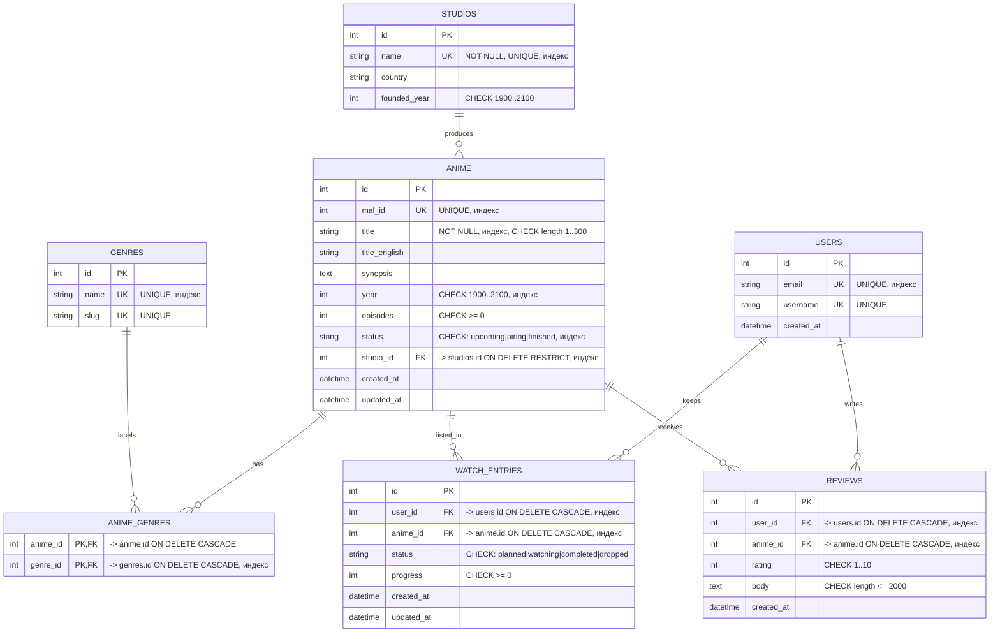

# ERD — Anime Portal

Схема БД: 6 сущностей и ассоциативная таблица. Связи: один-ко-многим (`studios → anime`,
`users → watch_entries`, `anime → reviews`) и многие-ко-многим (`anime ↔ genres` через
`anime_genres`).

## Ограничения целостности

| Ограничение | Где | Смысл |
| --- | --- | --- |
| `UNIQUE(users.email)`, `UNIQUE(users.username)` | `users` | один аккаунт на email/имя |
| `UNIQUE(anime.mal_id)` | `anime` | идемпотентность ETL по внешнему id |
| `UNIQUE(watch_entries.user_id, anime_id)` | `watch_entries` | один тайтл — одна запись в списке |
| `UNIQUE(reviews.user_id, anime_id)` | `reviews` | один отзыв на тайтл от пользователя |
| `CHECK status IN (...)` | `anime`, `watch_entries` | допустимые состояния |
| `CHECK rating BETWEEN 1 AND 10` | `reviews` | шкала оценок |
| `CHECK progress >= 0`, `CHECK episodes >= 0` | `watch_entries`, `anime` | неотрицательные счётчики |
| `CHECK year BETWEEN 1900 AND 2100` | `anime`, `studios` | правдоподобные годы |
| `FK ... ON DELETE CASCADE` | `anime_genres`, `watch_entries`, `reviews` | удаление тайтла/пользователя чистит зависимые строки |
| `FK studio_id ... ON DELETE RESTRICT` | `anime` | студию с тайтлами удалить нельзя |

## Индексы

Поиск и фильтрация: `anime.title`, `anime.year`, `anime.status`, `anime.studio_id`,
`anime.mal_id`, `genres.name`, `studios.name`, `users.email`,
`watch_entries.user_id`, `watch_entries.anime_id`, `reviews.anime_id`, `reviews.user_id`,
`anime_genres.genre_id`.

Схема создаётся и меняется только миграциями Alembic: `alembic upgrade head`,
откат — `alembic downgrade base` (проверяется тестом `tests/test_migrations.py`).
