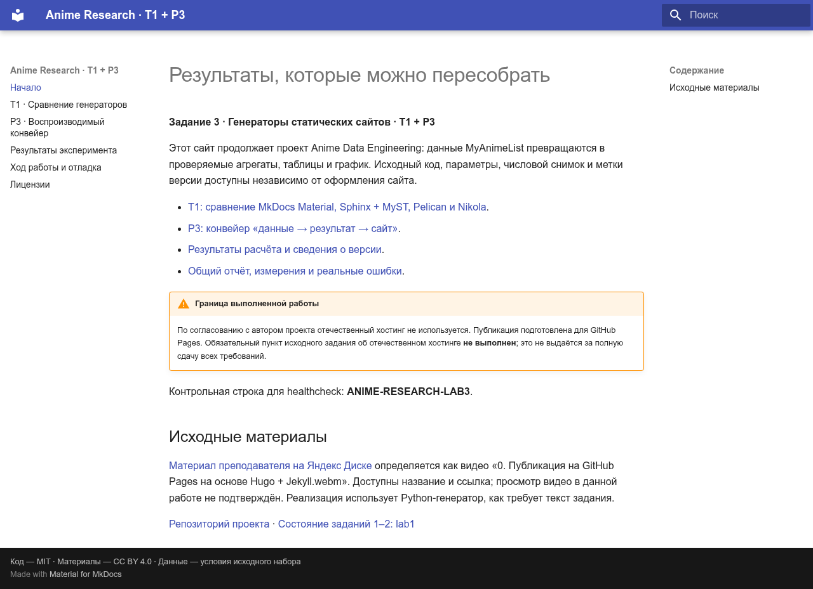
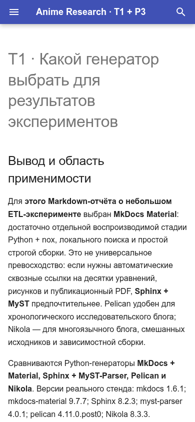
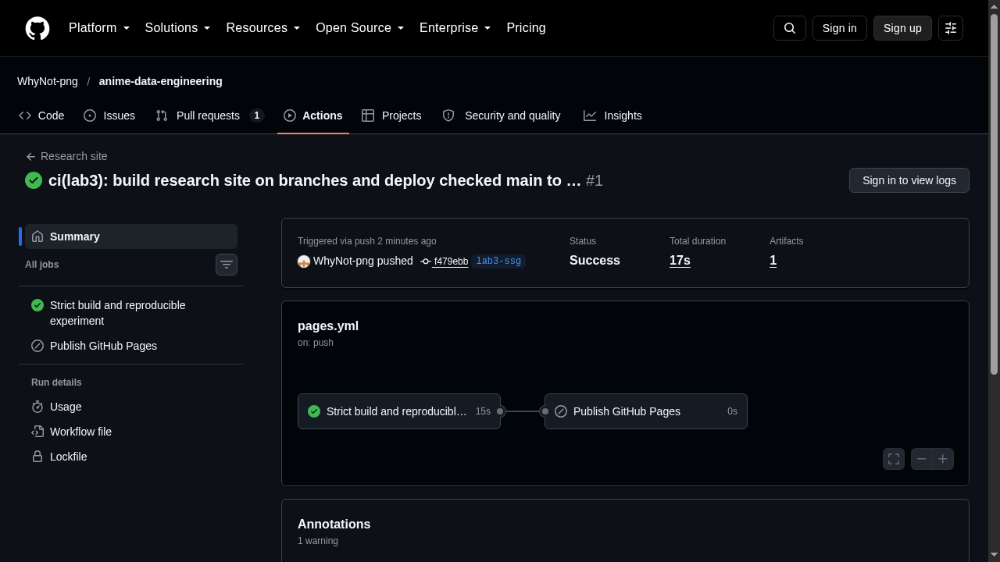
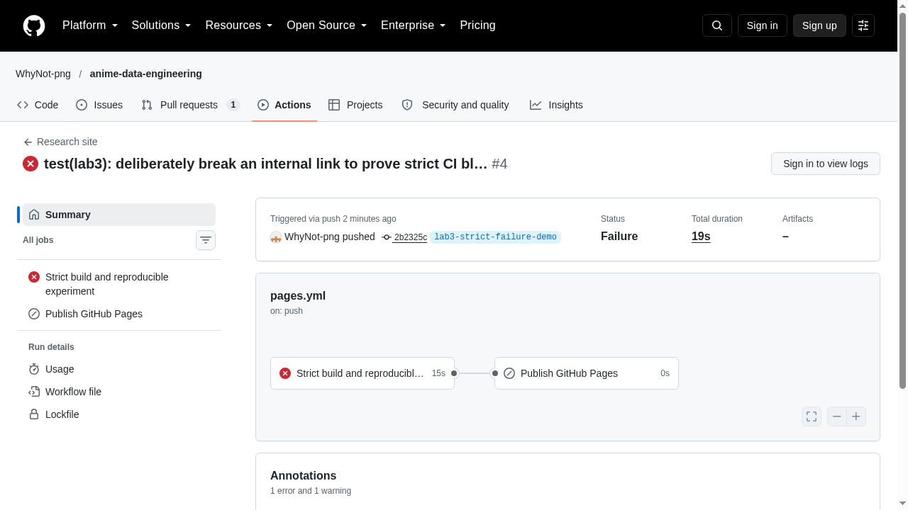

# Ход работы, проверки и отладка

## Объём выполненного задания

Выбраны **T1 и P3**. Стек: MkDocs Material, Python 3.12.12, uv + lock, nox,
GitHub Actions и официальный GitHub Pages artifact/deploy pipeline.
**Отечественный хостинг исключён по просьбе автора проекта**: соответствующий
пункт исходной работы не выполнен. Челлендж Marketplace не выполняется.

Репозиторий: [anime-data-engineering](https://github.com/WhyNot-png/anime-data-engineering).
Планируемый адрес: [GitHub Pages](https://whynot-png.github.io/anime-data-engineering/).
До первого успешного deploy этот адрес не является подтверждением публикации.
Отчёты: [T1](t1.md), [P3](p3.md), [расчёты и метки версии](results.md).

## Ход работы

| Шаг | Действие / результат |
| --- | --- |
| 1–4 | Python закреплён `.python-version`; uv создаёт `.venv`, lock фиксирует зависимости; virtualenv есть в dev-зависимостях pre-commit; `.gitignore` исключает кэш и сборки |
| 5–6 | MkDocs Material, навигация, локальный предпросмотр; `nox -s site` выполняет расчёт и `mkdocs build --strict` |
| 7–8 | Изменения в отдельной ветке/PR; подготовлен официальный Pages workflow; Source в настройках Pages должен быть GitHub Actions |
| 9–10 | Helios/отечественный хостинг не используется по согласованному ограничению |
| 11 | `site_url` содержит `/anime-data-engineering/`, directory URLs включены; ресурсы относительные; локальный тест выполнен под тем же подкаталогом |
| 12 | Контрольная строка, MathML, локальные ресурсы, наличие поискового индекса проверяются `scripts/check_site.py`; ограничения браузерной проверки указаны ниже |
| 13 | Код MIT, авторский текст CC BY 4.0, данные по исходным условиям ODbL; сторонние ресурсы отдельно атрибутированы |
| 14 | Реальные ошибки и отрицательный тест сборки сохранены ниже с логами |

## Варианты доставки на GitHub Pages

`peaceiris/actions-gh-pages` коммитит собранные файлы в ветку `gh-pages`;
нужны права записи в репозиторий, а Pages читает эту ветку. Это удобно для
`mike` и истории опубликованных деревьев, но смешивает публикацию с git-операциями.

В выбранном официальном подходе `upload-pages-artifact` загружает уже проверенный
`site/`, а `deploy-pages` публикует этот артефакт. Только deploy-job имеет
`pages: write` и `id-token: write`; build-job имеет `contents: read`. Личный PAT
не нужен. В настройках необходимо **Pages → Source = GitHub Actions**.
События: push любой ветки, pull_request и ручной запуск. Вне `main` — только сборка.
Публикация — только `main`, не из PR. После deploy проверяется успешный HTTP
и наличие `ANIME-RESEARCH-LAB3`. Секреты и требования fork-PR не ослабляются.

## Измерения

| Что измерено | Где числовая таблица / полный протокол |
| --- | --- |
| Чистая и повторная сборка, HTML страницы и объём результата для 4 SSG | [Таблица T1](t1.md), [JSON](evidence/ssg-benchmark.json) |
| Вес JS интерактивных библиотек, несжатый и gzip | [T1](t1.md), [JSON](evidence/interactive-weight.json) |
| Расчёт/чтение кэша и полный процесс MISS/HIT | [P3](p3.md), [JSON](evidence/p3-benchmark.json) |
| Изменение данных и графика | [P3](p3.md) |
| Время реального развёртывания | Пока не измерено: требуется успешная публикация; длительности нельзя заменять локальным временем сборки |

## Проверка доступности ресурсов

Формулы конвертируются из LaTeX в MathML во время сборки. Это избавляет страницу
от MathJax/KaTeX CDN, но переносимость MathML надо учитывать для старых браузеров.
График использует локальный `assets/vendor/chart.umd.js`; шрифты системные,
иконки встроены в ресурсы темы. Репозиторий указан обычной ссылкой: виджет статистики
репозитория удалён, поскольку он делал фоновые запросы на GitHub API.

Статическая проверка утверждает наличие `<math>`, графика, индекса поиска,
контрольной строки и локальных путей ко всем script/img/stylesheet.
Браузерная проверка главной и T1 проводилась с блокировкой внешних запросов.
[Протокол](evidence/site-qa.json) указывает точную область проверки.

**График:** канонический исходник и сгенерированные данные прошли статический preflight,
но дополнительная sandbox-проверка 320px остановилась с
`expected data-inline-chart-verification-rendered="true"`. Повторный запуск этой
проверки не выполнялся; визуальная корректность графика здесь **не заявляется**.
Полная доступная таблица результатов остаётся на странице независимо от JS.
После публикации требуется отдельная проверка графика в реальном браузере.

**Поиск:** индекс и языковые файлы локально присутствуют. Автоматизация ввода
в браузере при двух запросах пока оставила сообщение «Начните печатать для поиска»
и вернула 0 элементов. Поэтому интерактивная работа поиска **пока не подтверждена**;
это не считается успешной проверкой. После публикации требуется ручная проверка.

## Скриншоты локального сайта

Реальные PNG-снимки браузера упакованы в SVG-контейнеры без перерисовки содержимого.
Это скриншоты главной/T1, а не доказательство успешного внешнего деплоя или проверки графика.





## Отладка: реальные ошибки

### 1. Nikola: несогласованные языковые настройки

- **Ошибка:** `Could not find translations for pages/page00.md, check your TRANSLATIONS_PATTERN`.
- **Гипотеза:** после `nikola init` DEFAULT_LANG переключён с en на ru, а TRANSLATIONS остался английским.
- **Проверка:** просмотр `conf.py` и запуск того же fixtures-build с согласованной картой языков.
- **Решение:** `DEFAULT_LANG='ru'` и `TRANSLATIONS={'ru': ''}`; все 3 чистые и 3 повторные сборки завершились успешно.
- [Исходный лог](evidence/errors/nikola-translations.txt).

### 2. mypy: неоднородный dict вывел слишком общий тип

- **Ошибка:** `No overload variant of "int" matches argument type "object"`.
- **Гипотеза:** список словарей с `str`, `int`, `float` выводится как `dict[str, object]`.
- **Проверка:** ошибка воспроизводилась в сортировке/суммировании поля `count`.
- **Решение:** `TypedDict Group` с конкретными полями; повторный strict mypy прошёл без подавления ошибок.
- [Исходный лог](evidence/errors/mypy-group-types.txt).

### 3. Строгая сборка: намеренно сломанная ссылка

- **Ошибка:** `Doc file 'strict-failure-demo.md' contains a link 'missing-lab3-target.md', but the target is not found among documentation files`.
- **Гипотеза:** битые внутренние ссылки должны останавливать публикацию, а не только печатать предупреждение.
- **Проверка:** контролируемый отрицательный тест — добавлена ссылка на отсутствующий Markdown; `mkdocs build --strict` вернул код 1.
- **Решение:** тестовая страница удалена, повторная строгая сборка успешна. Это специально вызванный сбой, не случайная ошибка автора.
- [Настоящий лог](evidence/errors/strict-missing-link.txt).

### 4. Внешние запросы темы при отключённых CDN

- **Ошибка проверки:** фоновые обращения к `api.github.com/repos/...` при наличии `repo_url`.
- **Гипотеза:** Material загружает статистику репозитория, хотя шрифты и график локальные.
- **Проверка:** сетевые обращения браузера записаны при блокировке внешней сети.
- **Решение:** убран динамический repository widget, сохранена обычная ссылка на GitHub.

### 5. Ограничение проверки графика

- **Ошибка:** sandbox verifier не установил `data-inline-chart-verification-rendered` на 320px.
- **Гипотеза:** локальный относительный JS-путь мог не разрешиться в изолированной временной копии; причина не доказана.
- **Проверка:** статический preflight успешен, локальная проверка наличия файла успешна; повторная браузерная проверка не выполнялась.
- **Статус:** **не закрыто визуальным подтверждением**; таблица результатов опубликована как доступный fallback.

### 6. Не совпали русские автоякоря Markdown

- **Ошибка:** `report.md` ссылался на `t1.md#цена-интерактивности`, но такой якорь не был создан стандартным slugify.
- **Гипотеза:** автоматические идентификаторы русских заголовков не совпадают с написанными вручную.
- **Проверка:** строгая сборка вернула 4 предупреждения о несуществующих anchors.
- **Решение:** заменены ссылки на проверяемые страницы без выдуманных якорей; повторная strict-сборка успешна.
- [Лог](evidence/errors/strict-russian-anchors.txt).

## Реальные запуски GitHub Actions

Скриншоты ниже получены с публичных страниц GitHub, не из нарисованной имитации.
Успешный запуск доказывает **сборку** ветки, а не публикацию: deploy на ней пропущен.
Отрицательный запуск выполнен в отдельной ветке, она не предназначена для merge.

| Запуск | Результат | Длительность по UI, с | Область |
| --- | --- | ---: | --- |
| [40239002945](https://github.com/WhyNot-png/anime-data-engineering/actions/runs/40239002945) | success | 17 | Build only; deploy skipped on non-main branch |
| [40239057188](https://github.com/WhyNot-png/anime-data-engineering/actions/runs/40239057188) | failure (intentional missing internal link) | 19 | Strict build failed; deploy skipped |

[Машинный протокол](evidence/ci-runs.json).





После добавления научной стадии исходная матрица выявила сбой тестов только на
Windows (`Process completed with exit code 1`). Гипотеза — системная кодировка
при записи русскоязычного Markdown. Чтение/запись явно переведены на UTF-8;
[повторная матрица Python 3.12/3.13 × Ubuntu/Windows прошла](https://github.com/WhyNot-png/anime-data-engineering/actions/runs/40239260121).
Точное исключение из закрытых без входа логов не выдумывается.

## Текст pipeline с комментариями

```yaml
name: Research site

on:
  push:
    branches: ["**"]
  pull_request:
  workflow_dispatch:

permissions:
  contents: read

concurrency:
  group: research-site-${{ github.ref }}
  cancel-in-progress: true

jobs:
  build:
    name: Strict build and reproducible experiment
    runs-on: ubuntu-24.04
    timeout-minutes: 15
    env:
      UV_PYTHON: "3.12.12"
      UV_PYTHON_PREFERENCE: only-managed
    steps:
      - name: Checkout full version metadata
        uses: actions/checkout@d23441a48e516b6c34aea4fa41551a30e30af803 # v6
        with:
          persist-credentials: false
      - name: Set up locked uv
        uses: astral-sh/setup-uv@d0cc045d04ccac9d8b7881df0226f9e82c39688e # v6
        with:
          version: "0.13.5"
          enable-cache: true
          cache-dependency-glob: uv.lock
      - name: Install exact Python and dependencies
        run: |
          uv python install 3.12.12
          uv sync --locked --group docs
      - name: Restore content-addressed scientific results
        uses: actions/cache@caa296126883cff596d87d8935842f9db880ef25 # v5
        with:
          path: .cache/experiments
          key: experiment-${{ runner.os }}-${{ hashFiles('research/**', 'scripts/experiment.py', 'scripts/chart-template.html', 'uv.lock') }}
          restore-keys: |
            experiment-${{ runner.os }}-
      - name: Lint source
        run: uv run --locked ruff check .
      - name: Build scientific artifacts and strict site
        run: uv run --locked --group docs nox -s site
      - name: Verify control marker, search, MathML and local resources
        run: uv run --locked python scripts/check_site.py
      - name: Upload site artifact
        uses: actions/upload-pages-artifact@56afc609e74202658d3ffba0e8f6dda462b719fa # v3
        with:
          path: site

  deploy:
    name: Publish GitHub Pages
    # PRs and other branches build only; publication needs an explicit main run.
    if: github.ref == 'refs/heads/main' && github.event_name != 'pull_request'
    needs: build
    runs-on: ubuntu-24.04
    timeout-minutes: 10
    permissions:
      pages: write
      id-token: write
    environment:
      name: github-pages
      url: ${{ steps.deployment.outputs.page_url }}
    steps:
      - name: Deploy checked artifact
        id: deployment
        uses: actions/deploy-pages@d6db90164ac5ed86f2b6aed7e0febac5b3c0c03e # v4
      - name: Published HTTP and content healthcheck
        env:
          SITE_URL: ${{ steps.deployment.outputs.page_url }}
        run: |
          for attempt in 1 2 3 4 5; do
            status=$(curl --fail --silent --show-error --write-out "%{http_code}" "$SITE_URL" -o /tmp/published.html) || status=000
            if [ "$status" = "200" ] && grep -q 'ANIME-RESEARCH-LAB3' /tmp/published.html; then
              echo "HTTP 200 and control marker confirmed at $SITE_URL"
              exit 0
            fi
            sleep 10
          done
          echo "Published site failed HTTP/content healthcheck"
          exit 1
```

## Вывод

Для коротких Markdown-отчётов об обработке данных рекомендуем MkDocs Material +
внешнюю вычислительную стадию nox/Python + content-addressed cache + официальный
Pages artifact/deploy workflow. Результат читаем и без интерактивного JS — таблица
и метаданные доступны как HTML/CSV/JSON. Для сложной библиографии, сквозных ссылок
и издательского PDF предпочтительнее Sphinx + MyST/MyST-NB. Для больших расчётов
потребуется отдельный compute-процесс с версионированными артефактами.

Ограничения сдачи: отечественный хостинг исключён; до фактической публикации нельзя
заявлять успешный внешний deploy и цепочку «правка данных → push → новый публичный
график». Ошибка browser-verifier графика раскрыта отдельно и не заменена
неподтверждённым утверждением о корректности.
